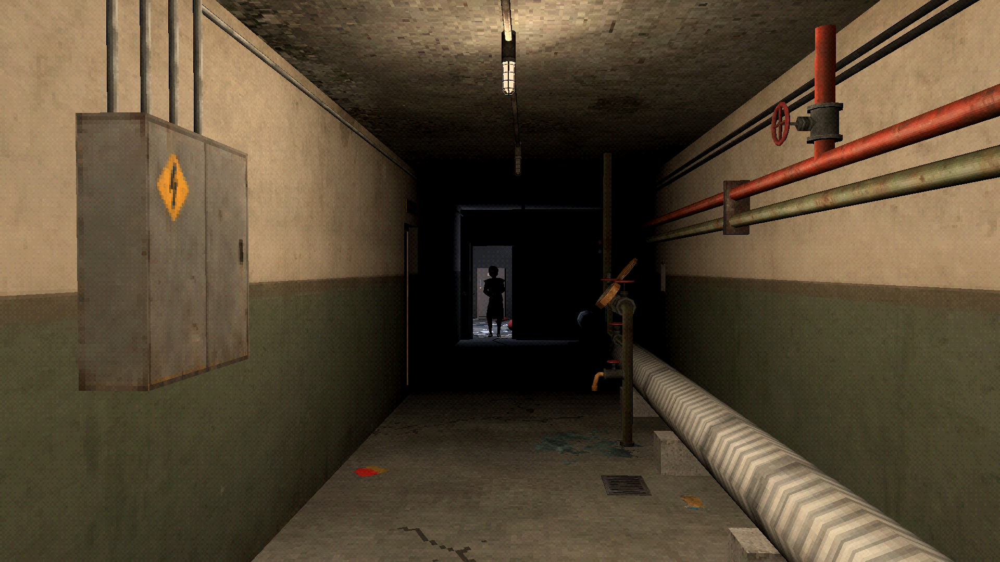
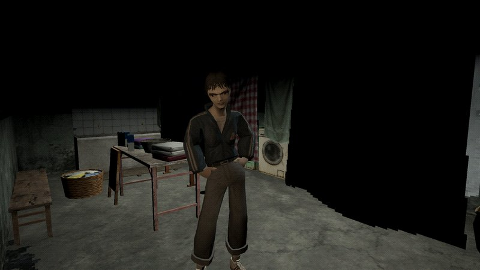
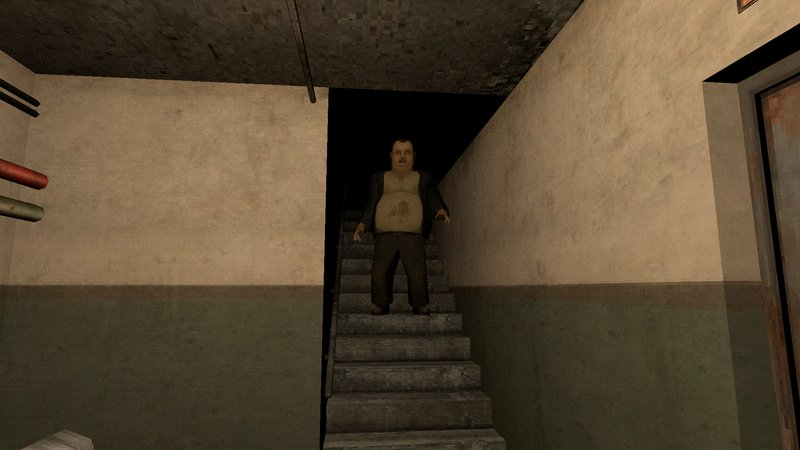
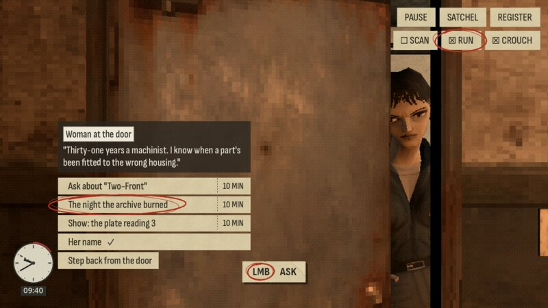

  

**An independent game studio in Åland, Finland.**

Logo by <a href="https://x.com/mewindson">Windson (Bhavik Chauhan)</a>

## Unaccounted

**A first-person murder mystery set in the 1980s Eastern Bloc.**

  
  
  

Explore an entire apartment building in this whodunit built on classic
detective work. Search its five floors, account for its residents, and find
out who killed a state official in the archive fire, and why.

Follow the evidence through documents, testimony, personal belongings, and the
building itself. A detail in one apartment can explain a contradiction in
another.

Coming to Windows, macOS and Linux. We're developing *Unaccounted* in
[Godot](https://godotengine.org/).

<b>Credits</b>

| Role | Credit |
|---|---|
| Characters | [Puldarrb](https://x.com/PulDarRB) |
| Environments | [Harol Amado Vivanco (Mc Pato)](https://x.com/Mc_Patooo) |
| Programming and design | [Tobias Svenblad](https://x.com/SevSignalStudio) |

## Get in touch

- [Report a bug or send feedback](https://github.com/Severed-Signal-Studios/.github/issues/new/choose)
- [Get help](https://github.com/Severed-Signal-Studios/.github/blob/main/SUPPORT.md)
- [Report a security problem](https://github.com/Severed-Signal-Studios/.github/security/policy)
- [Join us on Discord](https://discord.gg/nz9bkGb2Fv)

Our game and website code is private. Bug reports and feedback go to our public
[`.github` repository](https://github.com/Severed-Signal-Studios/.github).

We want to make games people can play regardless of disability, language or the
device they own. If something makes one of our games or our website hard or
impossible for you to use, tell us through the
[accessibility form](https://github.com/Severed-Signal-Studios/.github/issues/new?template=2-accessibility.yml).
Our [accessibility statement](https://github.com/Severed-Signal-Studios/.github/blob/main/ACCESSIBILITY.md)
says what we aim for.
