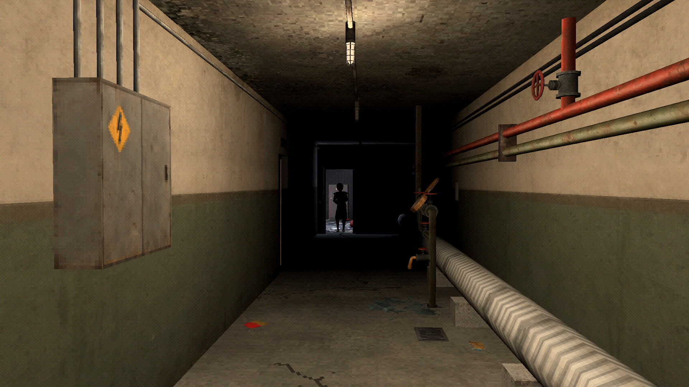

  

# Severed Signal Studios

**An independent game studio in Åland, Finland.**

[Website](https://severedsignal.com) · [Bluesky](https://bsky.app/profile/severedsignal.bsky.social) · [Discord](https://discord.gg/nz9bkGb2Fv) · [Facebook](https://www.facebook.com/severedsignal/) · [Reddit](https://www.reddit.com/user/SeveredSignal/)

## Unaccounted

**A first-person murder mystery set in the 1980s Eastern Bloc.**

Explore an entire apartment building in this whodunit built on logical
deduction. Search its five floors, account for its twelve residents, and find
out who set the fire.

Follow the evidence through documents, testimony, personal belongings, and the
building itself. A detail in one apartment can explain a contradiction in
another.

We're developing *Unaccounted* in [Godot](https://godotengine.org/).

[Wishlist on Steam](https://store.steampowered.com/app/747010/Unaccounted/)

## Get in touch

- [Report a bug or send feedback](https://github.com/Severed-Signal-Studios/.github/issues/new/choose)
- [Get help](https://github.com/Severed-Signal-Studios/.github/blob/main/SUPPORT.md)
- [Report a security problem](https://github.com/Severed-Signal-Studios/.github/security/policy)
- [Join us on Discord](https://discord.gg/nz9bkGb2Fv)

Our game and website code is private. Bug reports and feedback go to our public
[`.github` repository](https://github.com/Severed-Signal-Studios/.github).

We want to make games people can play regardless of disability, language or the
computer they own. If something stops you from playing,
[tell us](https://github.com/Severed-Signal-Studios/.github/issues/new?template=2-accessibility.yml).
