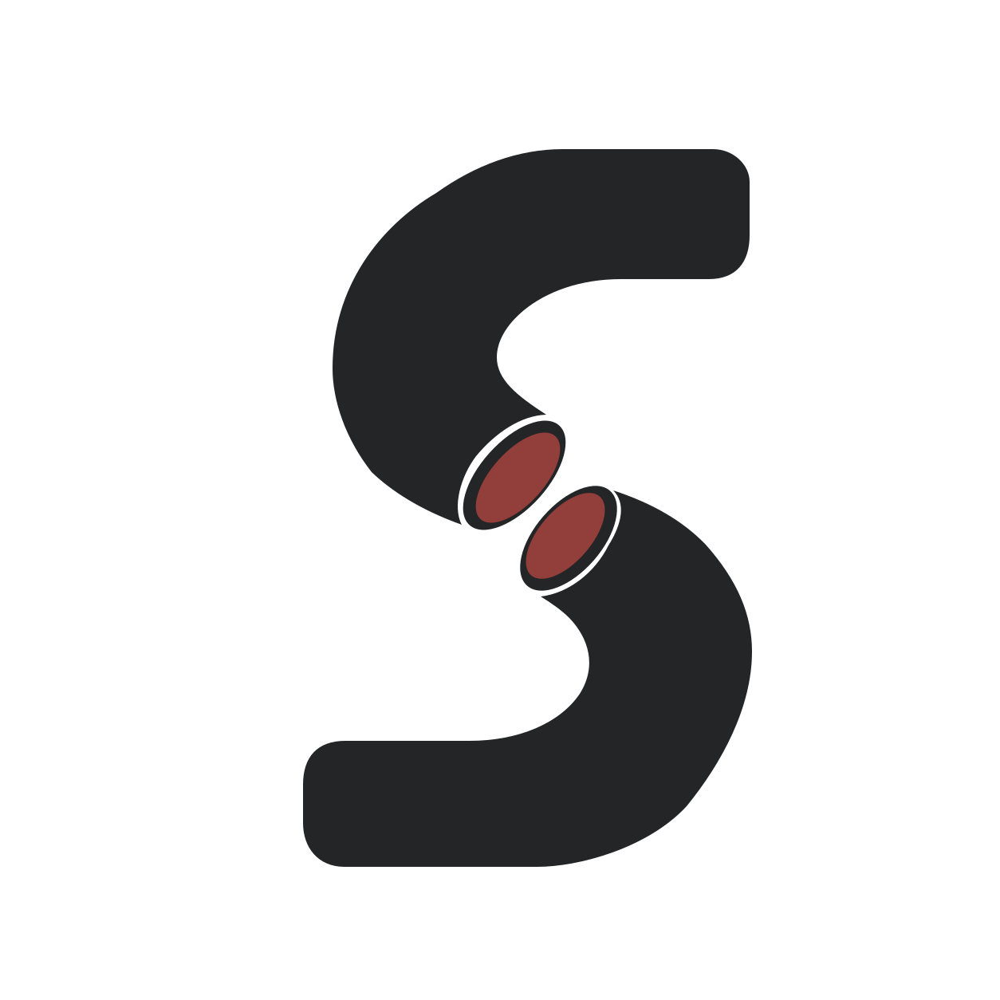

  <picture>
    <source media="(prefers-color-scheme: dark)" srcset="../assets/mark-on-dark.svg">
    
  </picture>

# Severed Signal Studios

**An independent game studio in Finland.**

[Website](https://severedsignal.com) · [Discord](https://discord.gg/jRH8Rv5b5y) · [Bluesky](https://bsky.app/profile/severedsignal.bsky.social)

## Unaccounted

The archive burned in the night and took the landlord with it. Now the building
is yours, and so is the register. Five days to write down who lives behind its
doors and what they did the night of the fire. Be careful what you write. The
state believes paper.

*Unaccounted* is a first-person 3D detective mystery built around environmental
clues and logical deduction. We're making it in [Godot](https://godotengine.org/).

<!-- Add the Steam store link here when the page goes live. -->

## Get in touch

- [Report a bug or send feedback](https://github.com/Severed-Signal-Studios/.github/issues/new/choose)
- [Get help](https://github.com/Severed-Signal-Studios/.github/blob/main/SUPPORT.md)
- [Report a security problem](https://github.com/Severed-Signal-Studios/.github/security/policy)
- [Join us on Discord](https://discord.gg/jRH8Rv5b5y)

Our game and website code is private. Bug reports and feedback go to our public
[`.github` repository](https://github.com/Severed-Signal-Studios/.github).

We want to make games people can play regardless of disability, language or the
computer they own. If something stops you from playing,
[tell us](https://github.com/Severed-Signal-Studios/.github/issues/new?template=2-accessibility.yml).
